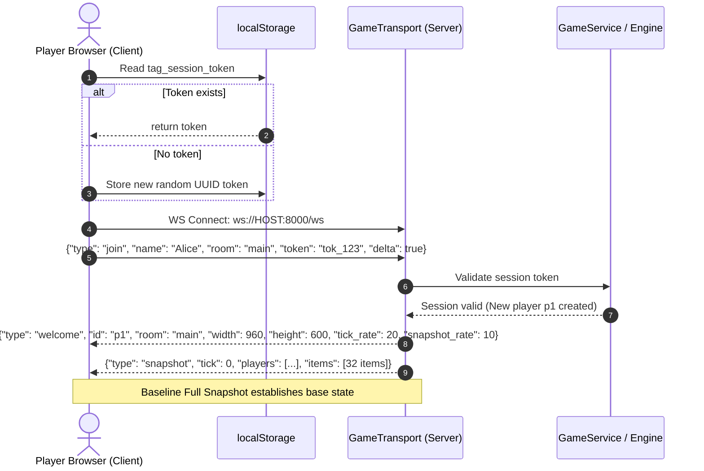
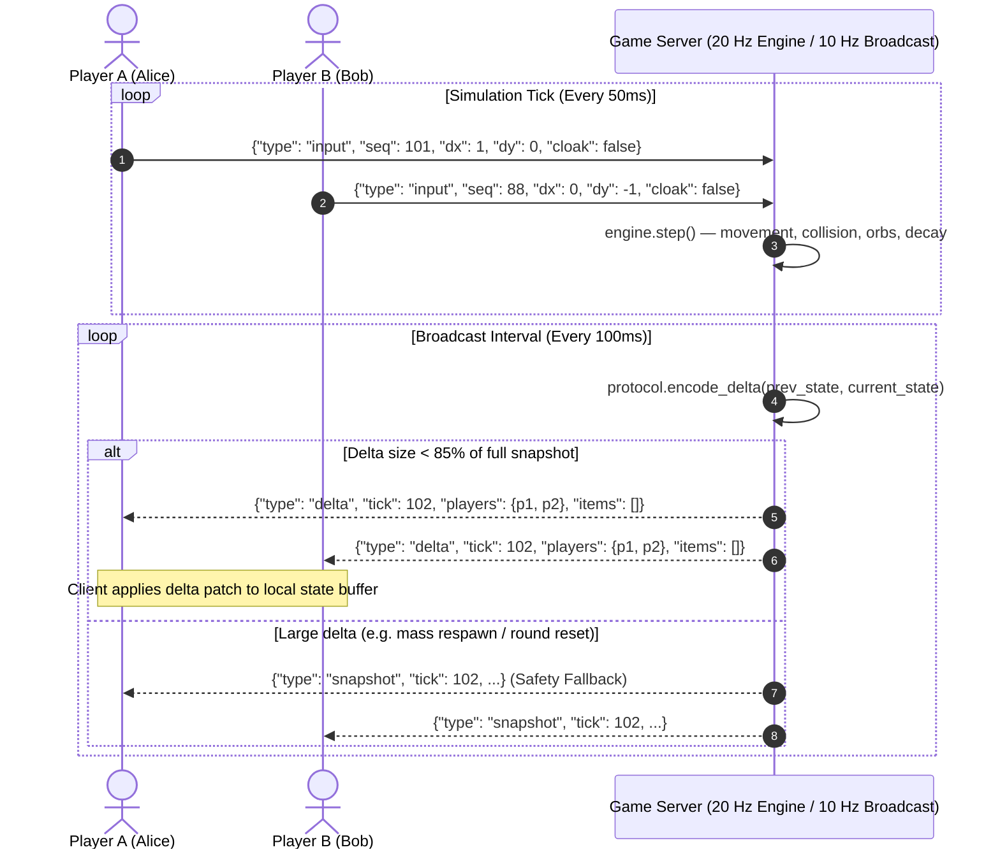
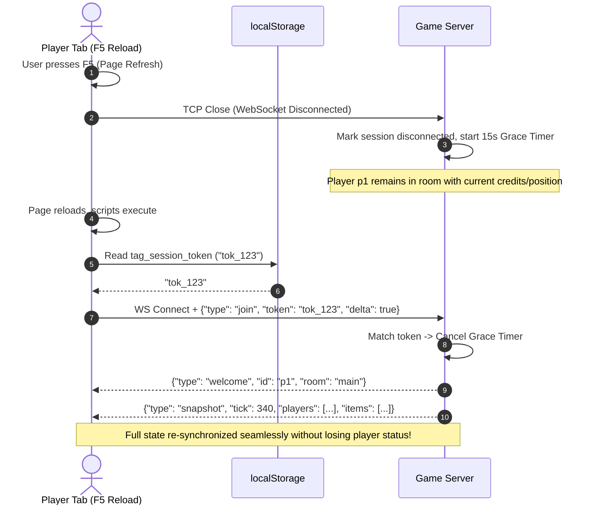
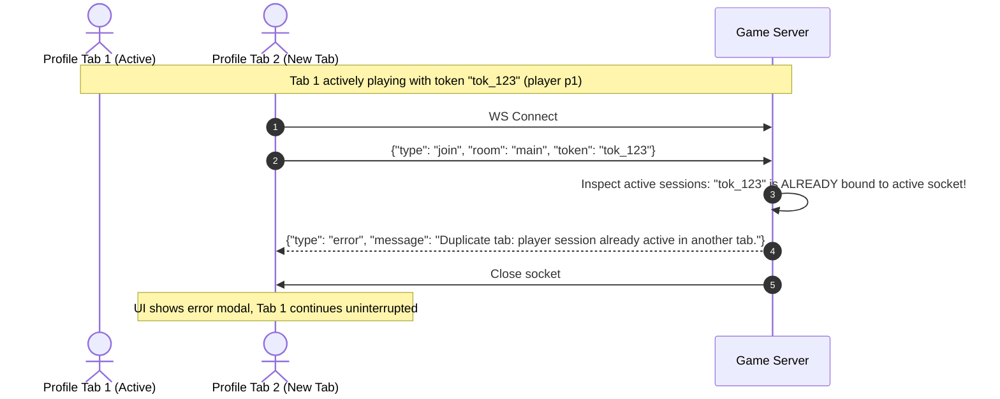

# Tag, You're Lagged! — Application-Layer Protocol Specification

> **Course**: Computer Networks (CO3093) — HK261  
> **Team**: GroupOfNeo  
> **Target**: Baseline Protocol (v1) vs. Optimized Adaptive Delta Protocol (v2)  
> **Reference Document**: Assignment Specification v1.2, Sections 4, 5, 7, and 9  

---

## 1. Executive Summary & Design Justification

Multiplayer real-time games on the web face a fundamental trade-off: **state consistency vs. bandwidth/latency**. 

The fixed game mechanics (Section 3) mandate:
- **Map Dimensions**: 960 × 600 continuous floating-point units.
- **Simulation Cadence**: 20 ticks/second (50ms interval).
- **Broadcast Cadence**: 10 updates/second (100ms interval).
- **Entities**: Up to 20 active players per room (`ROOM_CAPACITY = 20` per `rules.py`), 32 collectible orbs across 3 tiers (1, 3, 7 credits), active cloaking states (3s duration), continuous speed scaling, and periodic credit decay (every 5s).

### Why Baseline (v1) Falls Short:
The reference baseline protocol transmits a **Full World Snapshot** every 100ms over WebSocket:
- Redundantly serializes all 32 static/uncollected orbs in every packet (~1.4 KB).
- Redundantly serializes idle or non-moving players with full precision.
- Consumes ~2.2 KB per tick per client $\approx$ **22 KB/s per player** (176 Kbps). For a single full room of 20 players, server outbound traffic reaches **440 KB/s (3.52 Mbps)**. Across 5 full rooms (100 concurrent players), the server must push **17.6 Mbps** of pure JSON text payloads, causing TCP buffer bloat, queue delay spikes, and event-loop blocking.
- Emits no session identifiers: browser reloads generate orphaned zombie players, and duplicate tabs create phantom participants.

### The GroupOfNeo Optimized Design (v2):
Our design introduces **Protocol v2**:
1. **Persistent Session Identity**: Token-based identity in `localStorage` mapping to server-side player state, surviving browser reloads with a 15-second grace period.
2. **Duplicate Tab Policy**: Deterministic connection arbitration rejecting secondary connections with an explicit error.
3. **Adaptive Delta Compression**: Differential state updates sending only mutated attributes (moved players, collected/respawned orbs, and fresh events) with an automatic 85% safety fallback to Full Snapshot.
4. **Backward-Compatible Feature Negotiation**: Clients negotiate delta encoding via `join { delta: true }`. Legacy clients and instructor validation harnesses automatically receive standard Full Snapshots.

---

## 2. Protocol Specification: Baseline (v1) vs. Optimized (v2)

### 2.0 Communication Requirements & Message Classification
In accordance with Section 4 (Page 4) of the Specification, all interactions are categorized across four network dimensions: **Latency**, **Freshness**, **Reliability**, and **Ordering**.

| Message Group | Concrete Messages | Latency Req. | Freshness Req. | Reliability Req. | Ordering Req. | Delivery Strategy & Rationale |
|:---|:---|:---:|:---:|:---:|:---:|:---|
| **Session Control** | `join`, `welcome`, `rejoin`, `leave`, `resync`, `error` | Relaxed (<200ms) | Absolute (History matters) | **Strictly Reliable** (TCP) | **Strict FIFO** | Handshake, identity negotiation, and room lifecycle cannot tolerate missing packets. |
| **Player Action** | `input` | **Ultra-Low (<50ms)** | Ephemeral (Freshest tick wins) | Unreliable-tolerant (TCP) | Monotonic `seq` | Sent at 60 Hz; outdated inputs (`seq <= last_seq`) are dropped by the server without stalling. |
| **State Stream** | `snapshot`, `delta` | **Low (<100ms)** | Ephemeral (Current state supersedes past) | Tolerant to drop (Subsequent tick heals) | Monotonic `tick` | Sent at 10 Hz; clients apply incremental delta patches; missing base triggers `resync`. |
| **Diagnostics** | `ping`, `pong` | **Minimal (<20ms)** | Instantaneous | Best-effort | Unordered | Echoes client-side monotonic `nonce` to sample moving RTT without server buffering. |

---

### 2.1 Complete Message Catalog

| Message Type | Direction | v1 (Baseline) | v2 (Optimized) | Delivery / Reliability | Semantics & Purpose |
|:---|:---:|:---:|:---:|:---:|:---|
| `join` | C $\to$ S | `name`, `room` | `name`, `room`, `token`, `delta` | Reliable (WebSocket) | Initiates session. In v2, carries persistent `token` and negotiates delta capability. |
| `welcome` | S $\to$ C | `id`, `room`, `width`, `height`, `tick_rate`, `snapshot_rate`, `room_capacity` | Same fields as v1 (token bound in server memory) | Reliable (WebSocket) | Confirms entry, provides assigned `player_id` and authoritative room dimensions/rates. |
| `input` | C $\to$ S | `seq`, `dx`, `dy`, `cloak` | `seq`, `dx`, `dy`, `cloak` | Unreliable-ordered semantics over TCP | Client movement request (-1, 0, 1) and cloaking action. |
| `snapshot` | S $\to$ C | Full world state (`room`, `tick`, `phase`, `round`, `winner`, `players`, `items`, `events`) | Full world state (sent on join, resync, or >85% change fallback) | Unreliable-ordered semantics (freshest tick wins) | Canonical world snapshot (baseline default, v2 baseline fallback). |
| `delta` | S $\to$ C | *Not supported* | `tick`, `phase?`, `round?`, `winner?`, `players?`, `removed_players?`, `items?`, `events?` | Unreliable-ordered semantics | Differential update containing only changed entity fields and fresh events. |
| `rejoin` | C $\to$ S | `{}` | `{}` | Reliable (WebSocket) | Re-enters round after elimination or triggers next round (resets credits to 0). |
| `leave` | C $\to$ S | *Not in baseline* | `{}` | Reliable (WebSocket) | Explicit voluntary session termination; purges session token from server. |
| `resync` | C $\to$ S | *Not in baseline* | `{}` | Reliable (WebSocket) | Client requests immediate Full Snapshot on desynchronization or receipt of delta before base snapshot. |
| `ping` | C $\to$ S | `nonce` | `nonce` | Unreliable-ordered semantics | Round-trip latency measurement request. |
| `pong` | S $\to$ C | `nonce` | `nonce` | Unreliable-ordered semantics | Echoes ping nonce for RTT calculation. |
| `error` | S $\to$ C | `message` | `message` | Reliable (WebSocket) | Communicates operational rejections (`message: string`). |

---

### 2.2 Message Syntax, Fields, and Validation Rules

#### `join` (Client $\to$ Server)
```json
{
  "type": "join",
  "name": "Alice",
  "room": "main",
  "token": "tok_9f83a21b4e",
  "delta": true
}
```
- `name` (*string*, required): Display name, trimmed (1-18 characters per server rules).
- `room` (*string*, required): Target room identifier (alphanumeric, default: `"main"`).
- `token` (*string*, optional in v1, recommended in v2): UUID/hex session token from `localStorage`.
- `delta` (*boolean*, optional, default: `false`): Feature negotiation flag requesting delta updates.
- **Validation**: If `token` matches an already connected active socket in the room, server rejects the new socket with an `error` message (Duplicate Tab Policy).

#### `welcome` (Server $\to$ Client)
```json
{
  "type": "welcome",
  "id": "p1",
  "room": "main",
  "width": 960,
  "height": 600,
  "tick_rate": 20,
  "snapshot_rate": 10,
  "room_capacity": 20
}
```
- Server returns canonical environment dimensions and assigned `player_id`. The client-side session token is bound internally in `service.session_players`.

#### `input` (Client $\to$ Server)
```json
{
  "type": "input",
  "seq": 142,
  "dx": 1,
  "dy": 0,
  "cloak": false
}
```
- `seq` (*integer*, required): Monotonically increasing client-side input sequence number ($0 \le seq \le 2^{53}$).
- `dx`, `dy` (*integer*, required): Cardinal directions $\in \{-1, 0, 1\}$. Diagonal inputs ($|dx| + |dy| > 1$) are rejected by `parse_input()`.
- `cloak` (*boolean*, required): Activation request for invisibility ability (costs 5 credits, lasts 3s).

#### `delta` (Server $\to$ Client, v2 only)
```json
{
  "type": "delta",
  "tick": 420,
  "phase": "running",
  "round": 1,
  "winner": null,
  "players": [
    {
      "id": "p1",
      "name": "Alice",
      "x": 340.5,
      "y": 210.0,
      "credits": 12,
      "radius": 24.0,
      "alive": true,
      "invisible": false
    }
  ],
  "removed_players": [],
  "items": [
    {
      "id": 14,
      "tier": "small",
      "value": 1,
      "x": 512.0,
      "y": 300.0,
      "radius": 7.0
    }
  ],
  "events": [
    {
      "id": 12,
      "type": "collect",
      "tick": 420,
      "actor": "p1",
      "tier": "small",
      "value": 1
    }
  ]
}
```
- `players` (*array*, optional): List of `PlayerState` objects whose position, credits, alive status, or visibility changed compared to the previous snapshot.
- `removed_players` (*array of strings*, optional): List of player IDs removed from the room.
- `items` (*array*, optional): List of `ItemState` objects that respawned or changed state.
- `events` (*array*, optional): List of new `GameEvent` objects occurring in this broadcast window.
- **Safety Fallback**: If serialized delta size exceeds 85% of full snapshot size, `encode_delta()` automatically emits a standard `type: 'snapshot'`.

#### `resync` (Client $\to$ Server, v2 only)
```json
{
  "type": "resync"
}
```
- Emitted when the client receives a delta without having established a base snapshot. Server immediately responds with a Full Snapshot and clears the delta baseline cache.

#### `error` (Server $\to$ Client)
```json
{
  "type": "error",
  "message": "Duplicate tab: player session already active in another tab."
}
```
- `message` (*string*, required): Descriptive reason for rejected operation.

---

## 3. Session Lifecycle & State Synchronization

### 3.1 Persistent Identity across Reloads (Stage 1 Compliance)
1. On initial load, the browser client generates a cryptographically random session token (e.g., `crypto.randomUUID()`) and saves it in `localStorage`.
2. When the user navigates or presses F5 (Reload):
   - The old WebSocket terminates (TCP close event).
   - The server marks the player as `disconnected` and starts a **15-second grace timer**. The player is **not** immediately removed from the room, and their credits/position are preserved.
   - Upon page load, the new client connects and passes the existing `token` in the `join` packet.
   - The server identifies the matching `token`, cancels the grace timer, and reconnects the existing player identity (`player_id`) seamlessly.
3. **Game Mechanics Impact During Grace Window**:
   - **Stationary Presence**: The disconnected player entity remains stationary at its last known coordinates.
   - **Periodic Credit Decay**: In accordance with authoritative server rules (`rules.py`), decay continues every 5 seconds (100 ticks), subtracting $\lceil 0.02 \times \text{credits} \rceil$.
   - **Collision Vulnerability**: Active opponents with strictly greater credits can collide with and eliminate the stationary player, absorbing $\lceil 40\% \rceil$ of their credits. If this leaves only one surviving player, the round legitimately finishes.
   - **Grace Expiration**: If 15 seconds elapse without reconnection, the server cleans up the player entity via `service.leave()`.
   - **Voluntary Leave**: Clicking the UI "Leave" button emits an explicit `leave` message, immediately removing the player (`clear_session=True`) and skipping the grace window.

### 3.2 Duplicate Tab Policy
Per Section 4 (Page 5) of the Specification:
> *"Define how simultaneous tabs for one identity are handled, such as sharing the same identity or rejecting a duplicate active connection."*

**GroupOfNeo Policy**: **Strict Active Connection Arbitration (Reject Duplicate Tab)**.
- If a user opens a second tab in the same browser profile while Tab 1 is actively connected:
  1. Tab 2 reads the identical `tag_session_token` from `localStorage` and attempts to send `join`.
  2. The server detects that the session token is already bound to an active WebSocket connection.
  3. The server responds with:
     ```json
     {
       "type": "error",
       "message": "Duplicate tab: player session already active in another tab."
     }
     ```
  4. The server terminates Tab 2's socket without affecting Tab 1.
  5. Tab 2 UI displays: *"Session already active in another tab. Please close other tabs to continue."*

---

## 4. Message Sequence Diagrams (Mermaid)

### 4.1 Connection Handshake & Feature Negotiation


---

### 4.2 Gameplay Simulation & Adaptive Delta Broadcast Loop


---

### 4.3 Browser Reload & Grace Period Recovery


---

### 4.4 Duplicate Tab Rejection Policy


---

## 5. Architectural Processing Placement Across 5 Criteria

Per Section 4 (Page 4) of the Assignment Specification, processing must be analyzed and justified across **five core network and systems criteria**:

```
                       [ Architectural Pipeline ]
  Keyboard -> Input Buffering -> [WS Network] -> Server Engine -> Visibility Filtering
                                                       │
  Canvas 60 FPS <- Client State Buffer <- [WS Egress] <- Delta Encoding
```

### 5.1 Placement Breakdown Across Five Evaluation Criteria

| Processing Stage | Placement | 1. Latency Impact | 2. Traffic / Bandwidth | 3. Server Load | 4. Client Workload | 5. Scalability ($N \to 100$) |
|:---|:---:|:---|:---|:---|:---|:---|
| **Authoritative Simulation** | **Server** | Adds 1 RTT roundtrip; eliminates desync arbitration. | Neutral (Internal memory operations). | Moderate ($O(N)$ entity checks at 20 Hz). | Negligible (Zero simulation compute). | High: Central authority scales linearly per room. |
| **Input Buffering & Filtering** | **Hybrid** (Client 60 Hz $\to$ Server FIFO) | Immediate local keyboard response; server drops stale `seq <= last_seq`. | Low (~40 B/input packet). | Negligible (Integer comparisons). | Negligible (Event listeners). | High: Bounded input queues prevent memory exhaustion. |
| **Visibility Filtering (Cloak)** | **Server** | Zero additional latency; computed during tick step. | Eliminates hidden coordinates from packets. | Low ($O(P)$ check per viewer). | Negligible (Client only renders visible entities). | Critical: Prevents maphacks/cheating at the protocol boundary. |
| **Delta State Encoding** | **Server** | Tiny diff computation (<0.2ms per tick). | **Massive reduction (-88.26%)**: from 2.2 KB to 260 B. | Minor CPU trade-off for diff comparison. | Negligible (Processes smaller JSON payloads). | **Highest Impact**: Unblocks outbound TCP socket queues from 17.6 Mbps to 2.08 Mbps. |
| **State Buffer Reconciliation** | **Browser** | 0ms network latency; updates local snapshot instantly. | Eliminates full re-transmissions. | Zero (Offloaded from server). | Minor ($O(P + I)$ dictionary patch). | High: Each client reconstructs its own render state. |
| **Interpolation & Canvas Rendering** | **Browser** | Runs at native 60 FPS display refresh rate. | Zero network traffic. | Zero server compute. | Well within browser GPU/2D Canvas budget. | Infinitely scalable (independent of server entity count). |

### 5.2 Deep-Dive Justification on the 5 Core Criteria:

1. **Latency**:
   - Centralizing game decisions on the server introduces network RTT, but strictly prevents desynchronization disputes between clients.
   - Pushing 60 Hz raw inputs from the browser with monotonic sequence numbers (`seq`) ensures the server always executes the freshest intent without artificial buffer lag.
2. **Traffic (Bandwidth)**:
   - Performing **Delta Encoding** at the server boundary slashes egress traffic by **88.26%** (260 Bytes vs 2,215 Bytes per broadcast). Static entities (32 orbs) are filtered out, preventing redundant transport.
3. **Server Load**:
   - The Python server executes 20 simulation ticks/sec and 10 broadcast ticks/sec. By computing diffs only against the previous published snapshot per client, CPU overhead remains $<5\%$ for 100 concurrent bots while eliminating TCP send-buffer congestion.
4. **Client Workload**:
   - The browser is responsible for input sampling, receiving delta packets, and executing `applyDelta()`. Merging shallow object arrays in JavaScript takes $<0.1$ ms per frame, leaving the main UI thread 99% free for 60 FPS HTML5 Canvas rendering.
5. **Scalability**:
   - A naive server broadcasting 2.2 KB full snapshots to 100 concurrent players requires **17.6 Mbps** of pure outbound JSON bandwidth, causing kernel socket drops. Under our Optimized Delta design, bandwidth drops to **2.08 Mbps**, enabling seamless horizontal scaling across 25+ rooms on a single server core.

---

## 6. Failure Recovery & Resynchronization

1. **Stale/Out-of-Order Inputs**:
   - Every input packet contains a client-incremented `seq`.
   - The server enforces strictly sequential processing. Inputs arriving with `seq <= last_seen_seq` are discarded to prevent replay attacks or packet disorder jitter.
2. **Packet Loss / Desynchronization Recovery (`resync`)**:
   - Because WebSocket runs over TCP, packet delivery is ordered and reliable.
   - If the client detects a state desynchronization (such as receiving a `delta` packet without having a base snapshot in `this.lastSnapshot`), the client automatically emits `{"type": "resync"}`.
   - Upon receiving `resync`, the server immediately responds with an authoritative Full Snapshot (`snapshot`) and resets `last_snapshots[player_id] = None` to synchronize the differential baseline.
3. **Unexpected Server Restart**:
   - If the server restarts, all in-memory rooms are reset. Clients handle the close event with exponential backoff reconnection (`1s, 2s, 4s... max 10s`) and automatically rejoin room `"main"`.
